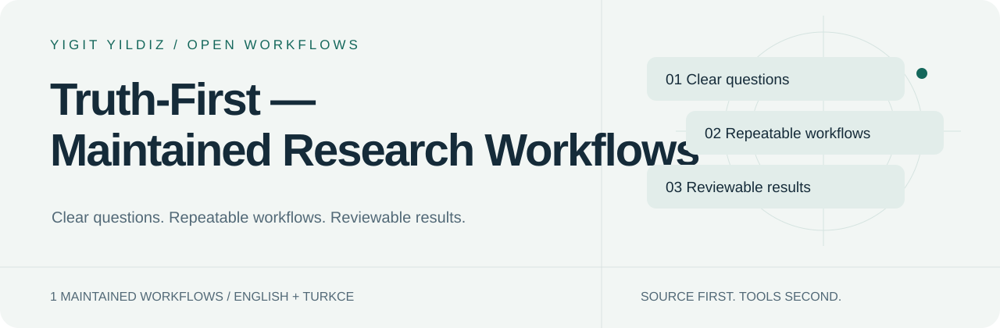

<picture>
  <source media="(prefers-color-scheme: dark)" srcset="assets/hero-dark.svg">
  
</picture>

# Truth-First — Maintained Research Workflows

[English](README.md) · [Türkçe](README.tr.md)

    

**Güncel araştırma merkezi içinde iddia doğrulama, kanıt bütünlüğü ve karar sorgulama.**

1 bakımı sürdürülen giriş noktası. Göreve göre birini seç; tüm kütüphaneyi bağlama yükleme.

[Başla](docs/INSTALL.md) · [Katalog](https://yigityildiz0.github.io/universal-ai-skill-library/) · [İndirmeler](DOWNLOADS.md) · [Bakım modeli](MAINTAINING.md)

## Bu sürümde yeni (2026.10.14)

- Gemini paketleri (CLI klasörleri ve filtreli Gemini uygulaması yüklemeleri), her uygulama için kurulum tablosu ve SHA-256 özetli gerçek GitHub Release.

## Hangi uygulamada?

| Uygulama | Paket |
|---|---|
| Claude Code | taşınabilir klasör → ~/.claude/skills |
| Claude.ai | skill başına bir yükleme ZIP'i |
| Codex / ChatGPT desktop | Codex.zip → ~/.codex/skills |
| ChatGPT web | hesap içe aktarma sunuyorsa eklenti ZIP'i |
| Gemini CLI / app | ~/.gemini/skills · Skills yükleme (filtreli kopya) |
| OpenCode · DeepSeek Harness | taşınabilir klasör + skills yolu |

Ayrıntılı adımlar: [Kurulum](docs/INSTALL.md). Dosyanın diskte olması etkin olduğunu kanıtlamaz; bir örnek istekle dene.

## Yapmak istediğin işi seç

<strong>Araştırma ve analiz</strong> · 1

| Skill | Ne işe yarar? |
|---|---|
| [research-analyst](docs/skills/research-analyst.tr.md) | Hızlı/derin araştırma, iddia doğrulama, sentez ve zaman damgalı video analizini yönlendirir. |

## Bir skill nasıl çalışır?

~~~mermaid
flowchart LR
 A[Your goal] --> B[Match the skill]
 B --> C[Load relevant module]
 C --> D[Use available tools]
 D --> E[Verify and explain]
~~~

Bu bir iş akışıdır; araç çalıştırıldığı veya bütün sonuçların doğrulandığı iddiası değildir. Her skill sayfasında örnek istek, tetikleme, mekanik, girdi/çıktı ve kaynak modüller var.

## Tek kaynak, kalıcı koleksiyonlar

Ana kaynak [Universal AI Skill Library](https://github.com/yigityildiz0/universal-ai-skill-library). Alan depoları aynı sürümün seçilmiş görünümleridir; ayrı ayrı çatallanıp elle düzenlenmez. Mevcut bağlantılar ve geçmiş korunur.

[All collections / Tüm koleksiyonlar](COLLECTIONS.md) · [Legacy/community resources](LEGACY.md) · [Licenses & provenance](docs/LICENSE-SCOPE.md)

## Dürüst kapsam

- Skill kurmak model eğitmek veya hesap/araç bağlamak değildir.
- Yerel dosya ile web hesabına yükleme farklıdır; desteklenen host akışını kullan.
- Ek ücretli API veya model indirme otomatik yapılmaz.
- Eski topluluk kataloğu güncel giriş noktalarının sayısına veya test iddiasına dahil değildir.
- Kaynak lisansları korunur; bütün üçüncü taraf içeriğine tek lisans varsayılmaz.

---
Maintained by [Yigit Yildiz](https://github.com/yigityildiz0) · Source edition 2026.10.14
